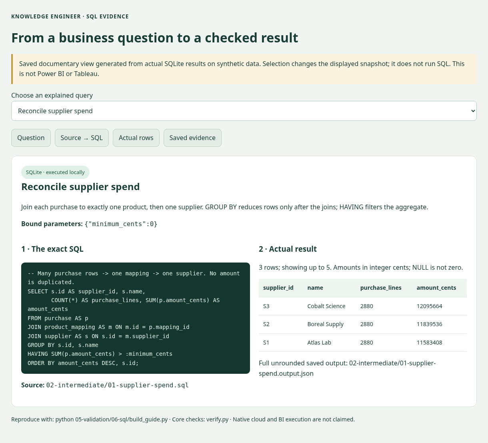

# SQL proficiency evidence / Evidencia de niveles SQL

**Visual walkthrough:** [Question → exact SQL → actual output](VISUAL-GUIDE.md) · [Open saved query view](https://beabustor.github.io/knowledge_engineer/sql/query-demo.en.html).

[Español](README.es.md) · [Project](../../README.md) · [Executable report](../../05-validation/06-sql/report.json)

This pathway uses the **same 8,640 synthetic purchase lines, 288 mappings and two catalog releases** as the project. Each query answers a procurement or data-quality question. It is technical evidence, not an automatic certification of the author's proficiency.

| Screenshot level | Implemented evidence | Justification / boundary |
| --- | --- | --- |
| No experience | Not a skill to implement | This repository contains executable SQL; a reader can start at Basic. |
| Basic — simple queries | [01-basic](01-basic/): parameters, WHERE, ORDER BY, LIMIT | Inspect the correct department/product without interpolating input. |
| Intermediate — joins, aggregations, subqueries, troubleshooting | [02-intermediate](02-intermediate/): joins, SUM/COUNT, GROUP BY/HAVING, NOT EXISTS | Reconcile supplier totals; isolate 30 obsolete mappings affecting 900 lines. The verifier reproduces and diagnoses a 96× join fan-out. |
| Advanced — joins, windows, complex queries | [03-advanced](03-advanced/): LAG, SUM OVER, DENSE_RANK, ROW_NUMBER, recursive and multi-stage CTEs, zero-filled months, deduplication, transactions | Prioritize financial exposure; compare calendar months; traverse taxonomy without double-counting; reject invalid review batches. Tests verify results and edge cases. |
| Expert — large-scale / production, BigQuery / Snowflake / Redshift | [04-production-design](04-production-design/): native-dialect design templates, partitioning/clustering/sort choices, operational checklist | **Design only, disabled and not executed on cloud engines.** No evidence of production scale, native syntax certification or expert operational experience. |

## Run without paid services

```sh
python 05-validation/06-sql/verify.py
```

Uses Python's standard-library SQLite, an in-memory database and frozen local JSON; no cloud SDK or credentials. The report records SQLite version, query hashes, 14 semantic checks and EXPLAIN plans. CI executes this command. The SQL pathway lives in the technical documentation; it adds no controls to the client's four-step demo.

## Schema and grain

`schema.sql` separates suppliers, products, purchase facts, calendar months, versioned concepts and review decisions. One purchase row is one original purchase line; integer cents avoid float reconciliation errors. Catalog drift is intentional: a baseline mapping may reference a retired v2 target, so mappings are not falsely forced into one current-release FK. Explicit reviewed targets have a composite release/identifier FK.

## Honest interpretation

A local `SCAN` → indexed `SEARCH` demonstrates a query-plan change with identical results. It does not demonstrate speedups on billions of rows. Warehouse optimizers, cost models, constraints and SQL dialects differ. Cloud examples require native tests, controlled execution and real operational evidence before claiming production expertise. Completing or copying examples does not by itself make a person “advanced”; being able to explain, adapt and debug them is essential.

<details>
<summary>Real query and output: supplier spend</summary>



Documentary browser rendering of real saved results; not a native BI screenshot or a live SQL editor.

</details>
