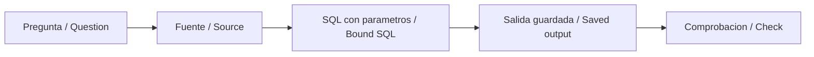

# SQL: from question to verified result

[Español](VISUAL-GUIDE.es.md)

Actual SQLite results on synthetic data. The documentary view and screenshots are not Power BI/Tableau or a live SQL editor.

[Vista documental HTML / Documentary HTML](../../09-docs/sql/query-demo.en.html)



## Queries and functionality

- [The exact 180-line public demo query](#demo)
- [Inspect a product](#q01)
- [Reconcile supplier spend](#q02)
- [Find broken classifications](#q03)
- [Compare calendar months](#q04)
- [Prioritize review work](#q05)
- [Follow taxonomy dependencies](#q06)
- [Keep the latest decision](#q07)
- [Apply one atomic review](#q08)

<a id="demo"></a>
## The exact 180-line public demo query

The exact exported SQL is run with a mapping view projecting the same six reviewed decisions. The six SKU filter prevents unrelated changes entering this result.

**Parameters:** `{}`

[Source code](../../03-pipelines/01-impact/glove-case.ts) · [Full saved output](guided-case.output.json)

<details>
<summary>Inspect the exact SQL</summary>

```sql
-- Scope: the six glove SKUs in the guided case, not the full dataset.
SELECT CASE WHEN m.status='valid' THEN m.target ELSE m.status END AS category,
       COUNT(*) AS purchase_lines,
       SUM(p.amount_cents) AS amount_cents
FROM purchase p JOIN mapping m ON p.mapping_id=m.id
WHERE m.id IN ('M0145', 'M0146', 'M0147', 'M0148', 'M0149', 'M0150')
GROUP BY category ORDER BY category;
```

</details>

**Actual result · 2 rows; first 5**

| category | purchase_lines | amount_cents |
| --- | --- | --- |
| LatexGlove | 90 | 386802 |
| NitrileGlove | 90 | 366045 |

Amounts are integer cents; NULL is not zero. The JSON output preserves all values without display rounding.

<a id="q01"></a>
## Inspect a product

WHERE selects one product and department; parameters are bound, not concatenated; ORDER BY makes LIMIT stable.

**Parameters:** `{"department": "Research", "mapping_id": "M0001", "row_limit": 100}`

[Source code](01-basic/01-filter.sql) · [Full saved output](01-basic/01-filter.output.json)

<details>
<summary>Inspect the exact SQL</summary>

```sql
-- Business question: inspect glove lines reported by the Research department.
SELECT p.id, p.month, p.quantity, p.amount_cents
FROM purchase AS p
WHERE p.department = :department
  AND p.mapping_id = :mapping_id
ORDER BY p.month, p.id
LIMIT :row_limit;
```

</details>

**Actual result · 10 rows; first 5**

| id | month | quantity | amount_cents |
| --- | --- | --- | --- |
| P00001 | 2026-01 | 1 | 150 |
| P00007 | 2026-01 | 7 | 1050 |
| P00013 | 2026-01 | 6 | 900 |
| P00019 | 2026-01 | 5 | 750 |
| P00025 | 2026-01 | 4 | 600 |

Amounts are integer cents; NULL is not zero. The JSON output preserves all values without display rounding.

<a id="q02"></a>
## Reconcile supplier spend

Join each purchase to exactly one product, then one supplier. GROUP BY reduces rows only after the joins; HAVING filters the aggregate.

**Parameters:** `{"minimum_cents": 0}`

[Source code](02-intermediate/01-supplier-spend.sql) · [Full saved output](02-intermediate/01-supplier-spend.output.json)

<details>
<summary>Inspect the exact SQL</summary>

```sql
-- Many purchase rows -> one mapping -> one supplier. No amount is duplicated.
SELECT s.id AS supplier_id, s.name,
       COUNT(*) AS purchase_lines, SUM(p.amount_cents) AS amount_cents
FROM purchase AS p
JOIN product_mapping AS m ON m.id = p.mapping_id
JOIN supplier AS s ON s.id = m.supplier_id
GROUP BY s.id, s.name
HAVING SUM(p.amount_cents) > :minimum_cents
ORDER BY amount_cents DESC, s.id;
```

</details>

**Actual result · 3 rows; first 5**

| supplier_id | name | purchase_lines | amount_cents |
| --- | --- | --- | --- |
| S3 | Cobalt Science | 2880 | 12095664 |
| S2 | Boreal Supply | 2880 | 11839536 |
| S1 | Atlas Lab | 2880 | 11583408 |

Amounts are integer cents; NULL is not zero. The JSON output preserves all values without display rounding.

<a id="q03"></a>
## Find broken classifications

NOT EXISTS checks whether the target is active in v2. Only then aggregate dependent purchases. No inactive target is silently replaced.

**Parameters:** `{"release": "scenario-v2"}`

[Source code](02-intermediate/02-review-queue.sql) · [Full saved output](02-intermediate/02-review-queue.output.json)

<details>
<summary>Inspect the exact SQL</summary>

```sql
-- Anti-semi join: only mappings whose target is absent or retired in the new release.
SELECT m.id, m.supplier_id, m.target,
       COUNT(p.id) AS affected_lines, SUM(p.amount_cents) AS affected_cents
FROM product_mapping AS m
JOIN purchase AS p ON p.mapping_id = m.id
WHERE NOT EXISTS (
 SELECT 1 FROM concept AS c
 WHERE c.version = :release AND c.id = m.target AND c.deprecated = 0
)
GROUP BY m.id, m.supplier_id, m.target
ORDER BY affected_cents DESC, m.id;
```

</details>

**Actual result · 30 rows; first 5**

| id | supplier_id | target | affected_lines | affected_cents |
| --- | --- | --- | --- | --- |
| M0228 | S3 | MercuryThermometer | 30 | 187902 |
| M0226 | S2 | MercuryThermometer | 30 | 185211 |
| M0224 | S1 | MercuryThermometer | 30 | 182520 |
| M0227 | S3 | MercuryThermometer | 30 | 179975 |
| M0225 | S2 | MercuryThermometer | 30 | 177330 |

Amounts are integer cents; NULL is not zero. The JSON output preserves all values without display rounding.

<a id="q04"></a>
## Compare calendar months

monthly aggregates at supplier/month grain; filled adds missing months; LAG reads the previous calendar month; SUM OVER accumulates with explicit ROWS; zero denominators return NULL.

**Parameters:** `{}`

[Source code](03-advanced/01-monthly-windows.sql) · [Full saved output](03-advanced/01-monthly-windows.output.json)

<details>
<summary>Inspect the exact SQL</summary>

```sql
-- Zero-filled supplier/month matrix makes LAG mean previous calendar month.
WITH monthly AS (
 SELECT m.supplier_id, p.month, SUM(p.amount_cents) AS amount_cents
 FROM purchase AS p JOIN product_mapping AS m ON m.id = p.mapping_id
 GROUP BY m.supplier_id, p.month
), filled AS (
 SELECT s.id AS supplier_id, d.month, COALESCE(m.amount_cents,0) AS amount_cents
 FROM supplier AS s CROSS JOIN dim_month AS d
 LEFT JOIN monthly AS m ON m.supplier_id = s.id AND m.month = d.month
), windowed AS (
 SELECT supplier_id, month, amount_cents,
        LAG(amount_cents) OVER(PARTITION BY supplier_id ORDER BY month) AS previous_cents,
        SUM(amount_cents) OVER(PARTITION BY supplier_id ORDER BY month
                              ROWS BETWEEN UNBOUNDED PRECEDING AND CURRENT ROW) AS running_cents
 FROM filled
)
SELECT supplier_id, month, amount_cents, previous_cents,
       amount_cents - previous_cents AS delta_cents,
       CASE WHEN previous_cents IS NULL OR previous_cents=0 THEN NULL
            ELSE 100.0 * (amount_cents-previous_cents)/previous_cents END AS growth_pct,
       running_cents
FROM windowed ORDER BY supplier_id, month;
```

</details>

**Actual result · 18 rows; first 5**

| supplier_id | month | amount_cents | previous_cents | delta_cents | growth_pct | running_cents |
| --- | --- | --- | --- | --- | --- | --- |
| S1 | 2026-01 | 2194512 | NULL | NULL | NULL | 2194512 |
| S1 | 2026-02 | 1994832 | 2194512 | -199680 | -9.099061659266388 | 4189344 |
| S1 | 2026-03 | 1795152 | 1994832 | -199680 | -10.009865492432445 | 5984496 |
| S1 | 2026-04 | 1595472 | 1795152 | -199680 | -11.123292066632798 | 7579968 |
| S1 | 2026-05 | 1752120 | 1595472 | 156648 | 9.818285748668732 | 9332088 |

Amounts are integer cents; NULL is not zero. The JSON output preserves all values without display rounding.

<a id="q05"></a>
## Prioritize review work

inactive identifies broken mappings; exposure aggregates their cents; DENSE_RANK preserves exposure ties; ROW_NUMBER orders each supplier queue with an ID tie-break.

**Parameters:** `{"release": "scenario-v2"}`

[Source code](03-advanced/02-prioritize-impact.sql) · [Full saved output](03-advanced/02-prioritize-impact.output.json)

<details>
<summary>Inspect the exact SQL</summary>

```sql
-- CTEs isolate release drift, aggregate at mapping grain, then rank by financial exposure.
WITH inactive AS (
 SELECT m.id,m.supplier_id,m.target
 FROM product_mapping AS m
 LEFT JOIN concept AS c ON c.version=:release AND c.id=m.target
 WHERE c.id IS NULL OR c.deprecated=1
), exposure AS (
 SELECT i.id,i.supplier_id,i.target,COUNT(*) AS affected_lines,
        SUM(p.amount_cents) AS affected_cents
 FROM inactive AS i JOIN purchase AS p ON p.mapping_id=i.id
 GROUP BY i.id,i.supplier_id,i.target
)
SELECT *,
 DENSE_RANK() OVER(ORDER BY affected_cents DESC) AS global_priority,
 ROW_NUMBER() OVER(PARTITION BY supplier_id ORDER BY affected_cents DESC,id) AS supplier_priority,
 1.0 * affected_cents / NULLIF(SUM(affected_cents) OVER(),0) AS exposure_share
FROM exposure ORDER BY affected_cents DESC,id;
```

</details>

**Actual result · 30 rows; first 5**

| id | supplier_id | target | affected_lines | affected_cents | global_priority | supplier_priority | exposure_share |
| --- | --- | --- | --- | --- | --- | --- | --- |
| M0228 | S3 | MercuryThermometer | 30 | 187902 | 1 | 1 | 0.04794951039196968 |
| M0226 | S2 | MercuryThermometer | 30 | 185211 | 2 | 1 | 0.04726281130167372 |
| M0224 | S1 | MercuryThermometer | 30 | 182520 | 3 | 1 | 0.04657611221137777 |
| M0227 | S3 | MercuryThermometer | 30 | 179975 | 4 | 2 | 0.04592666992791318 |
| M0225 | S2 | MercuryThermometer | 30 | 177330 | 5 | 2 | 0.045251709283605196 |

Amounts are integer cents; NULL is not zero. The JSON output preserves all values without display rounding.

<a id="q06"></a>
## Follow taxonomy dependencies

The recursive CTE discovers unique child/ancestor pairs. EXISTS includes each purchase once even if the taxonomy has several paths.

**Parameters:** `{"release": "scenario-v1", "category": "Supplies"}`

[Source code](03-advanced/03-taxonomy-spend.sql) · [Full saved output](03-advanced/03-taxonomy-spend.output.json)

<details>
<summary>Inspect the exact SQL</summary>

```sql
-- UNION deduplicates ancestor pairs; EXISTS avoids multiplying a purchase along multiple paths.
WITH RECURSIVE ancestors(child,ancestor) AS (
 SELECT id,id FROM concept WHERE version=:release AND deprecated=0
 UNION
 SELECT a.child,b.parent FROM ancestors AS a
 JOIN broader AS b ON b.child=a.ancestor AND b.version=:release
 JOIN concept AS c ON c.id=b.parent AND c.version=:release AND c.deprecated=0
)
SELECT COUNT(*) AS purchase_lines, COALESCE(SUM(p.amount_cents),0) AS amount_cents
FROM purchase AS p JOIN product_mapping AS m ON m.id=p.mapping_id
WHERE EXISTS(SELECT 1 FROM ancestors AS a WHERE a.child=m.target AND a.ancestor=:category);
```

</details>

**Actual result · 1 rows; first 5**

| purchase_lines | amount_cents |
| --- | --- |
| 8640 | 35518608 |

Amounts are integer cents; NULL is not zero. The JSON output preserves all values without display rounding.

<a id="q07"></a>
## Keep the latest decision

ROW_NUMBER partitions events by mapping and orders timestamp DESC then event_id DESC. The second ordering makes equal timestamps deterministic.

**Parameters:** `{}`

[Source code](03-advanced/04-deduplicate-events.sql) · [Full saved output](03-advanced/04-deduplicate-events.output.json)

<details>
<summary>Inspect the exact SQL</summary>

```sql
-- Latest event wins; event_id breaks timestamp ties deterministically.
-- The event fixture is test-created, isolated from the frozen purchase records.
WITH ranked AS (
 SELECT *,ROW_NUMBER() OVER(PARTITION BY mapping_id ORDER BY event_time DESC,event_id DESC) AS sequence
 FROM mapping_event
)
SELECT mapping_id,target,event_id FROM ranked WHERE sequence=1 ORDER BY mapping_id;
```

</details>

**Actual result · 1 rows; first 5**

| mapping_id | target | event_id |
| --- | --- | --- |
| M0001 | Latest | 3 |

Amounts are integer cents; NULL is not zero. The JSON output preserves all values without display rounding.

<a id="q08"></a>
## Apply one atomic review

SAVEPOINT opens a review batch. A parameterized upsert inserts or updates the decision; RELEASE commits this savepoint. Caller rollback is independently verified for a failing batch.

**Parameters:** `{"mapping_id": "M0001", "release": "scenario-v2", "target": "Water", "actor": "example-reviewer", "reason": "Synthetic documentary example"}`

[Source code](03-advanced/05-review-transaction.sql) · [Full saved output](03-advanced/05-review-transaction.output.json)

<details>
<summary>Inspect the exact SQL</summary>

```sql
-- One atomic review batch. Caller binds values and handles rollback on constraint failure.
SAVEPOINT review_batch;
INSERT INTO review_decision(mapping_id,version,target,actor,reason)
VALUES(:mapping_id,:release,:target,:actor,:reason)
ON CONFLICT(mapping_id,version) DO UPDATE SET
 target=excluded.target,actor=excluded.actor,reason=excluded.reason;
RELEASE review_batch;
```

</details>

**Actual result · 1 rows; first 5**

| mapping_id | version | target | actor | reason |
| --- | --- | --- | --- | --- |
| M0001 | scenario-v2 | Water | example-reviewer | Synthetic documentary example |

Amounts are integer cents; NULL is not zero. The JSON output preserves all values without display rounding.

## BI / Power BI / Tableau

[Data and measures connected to the same case](../04-bi/README.md)

## BigQuery / Snowflake / Redshift

Each template has `example.expected.json`: a SQLite reference output, **not cloud execution**. [Limits and preparation](04-production-design/README.md).
