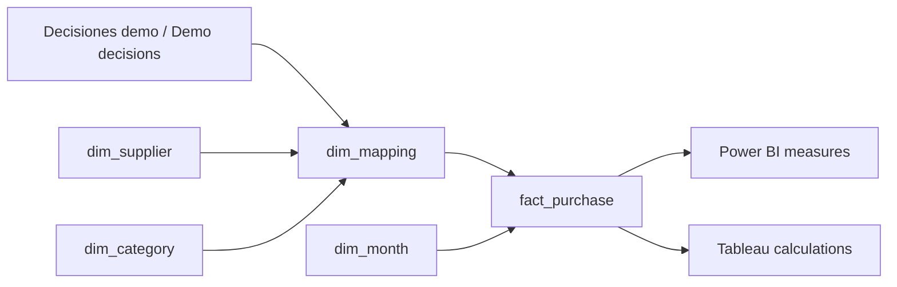

# BI connected to the demo / BI conectado a la demo

[Project / Proyecto](../../README.es.md) · [Actual export output / Salida real](output.json)

**EN.** This is one shared star export for Power BI and Tableau, generated from the same engine and six glove-review decisions as the public demo. It is not an unrelated dashboard dataset. CSV outputs and relationship reconciliation execute locally; native Power BI/Tableau reports have not been executed or validated here. No `.pbix` or `.twbx` is claimed.

**ES.** Una exportación en estrella para Power BI y Tableau, generada con el mismo motor y las seis decisiones de guantes de la demo. No es otro conjunto de datos inconexo. Se ejecutan la exportación CSV y la conciliación de relaciones; no se han ejecutado ni validado aquí informes nativos Power BI/Tableau. No se afirma disponer de `.pbix` ni `.twbx`.



## One grain / Una granularidad

- `fact_purchase`: **one original purchase line, once** / una línea original, una sola vez: 8,640 rows.
- `dim_mapping`: one SKU mapping with original target, reviewed target and status / una correspondencia por SKU: 288 rows.
- Supplier → mapping, category → mapping and mapping → purchase: one-to-many, single-direction dimension filters / relaciones uno-a-muchos y filtro desde dimensiones.
- Month → purchase: one-to-many. Do not also connect supplier directly to fact: it creates a second filter path. / No añadir otro camino proveedor → hechos.
- Do not join on translated labels or material names; keys remain stable. / Usar claves, no etiquetas traducidas ni nombres de material.

## Same case, same answers / Mismo caso, mismas respuestas

Set **DimMapping.original_target = ProtectiveGlove**. / Aplicar ese filtro para reproducir la demo.

| Measure / Medida | Glove case / Guantes | Entire export / Exportación completa |
| --- | --- | --- |
| Purchase lines / Líneas | 180 | 8,640 |
| Nitrile / Nitrilo | 90 | Select the glove filter / usar filtro de guantes |
| Latex / Látex | 90 | Select the glove filter / usar filtro de guantes |
| Unresolved lines / Pendientes | 0 | **720** |
| Amount, synthetic EUR cents / Importe sintético | 752,847 | 35,518,608 |

Only the guided case's six mappings are reviewed. Other changes are still unresolved. This snapshot is neither the unrevised v2 nor the full authored-review scenario. / Solo se revisan las seis correspondencias de la demo; los otros cambios siguen pendientes. No mezclar este estado con v2 sin revisar ni con el escenario de revisión global.

## Reproduce / Reproducir

```sh
python 03-pipelines/04-bi/export.py
```

Requires Python standard library and Node.js 24, no cloud credentials. The exporter loads CSVs into an independent SQLite database and checks unique dimension keys, joins, row counts, cents and material counts. [Manifest and hashes](manifest.json).

- [Power BI: import and measures / importación y medidas](power-bi/README.md)
- [Tableau: relationships and calculations / relaciones y cálculos](tableau/README.md)
- [Saved data / Datos guardados](data/README.md)

Desktop authoring and public sharing/service licensing are different. No paid license is required to generate these files; verify current Power BI/Tableau sharing and hosting conditions before publishing an actual report. / Generar estos archivos no requiere licencia de pago; comprobar las condiciones actuales de publicación y compartición antes de desplegar informes nativos.
