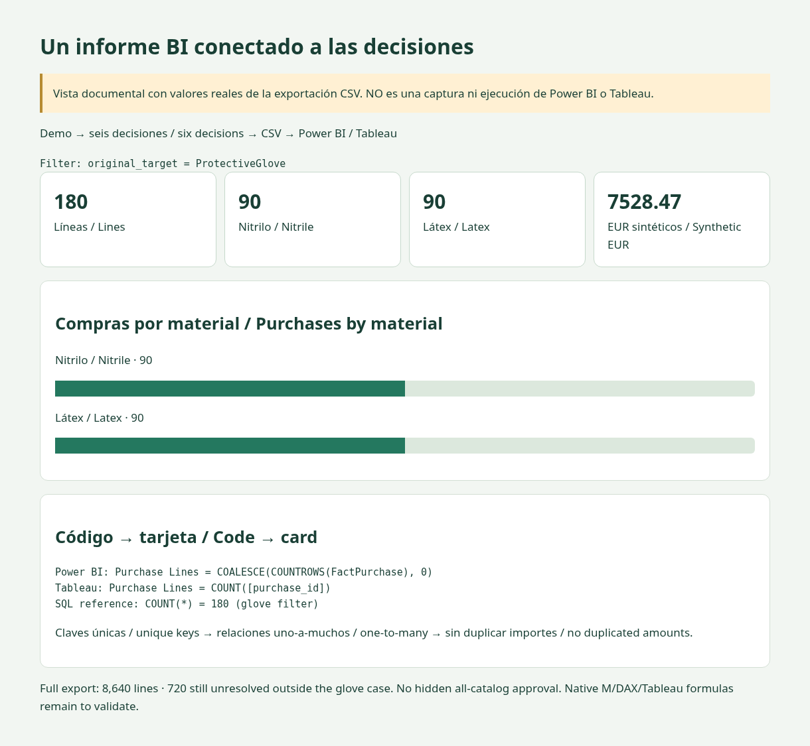

# Power BI · prepared, not natively validated / preparado, no validado de forma nativa

[Shared data model / Modelo común](../README.md) · [Saved expected result / Resultado esperado guardado](expected-output.json)

1. Regenerate CSVs / Regenerar CSV: `python 03-pipelines/04-bi/export.py`.
2. In Power BI Desktop create Text parameter `DataFolder` with the local absolute `data` folder. Create blank query `Star` using [load-star.pq](load-star.pq). / Crear parámetro de carpeta y consulta vacía con ese archivo.
3. Create separate queries `FactPurchase = Star[FactPurchase]`, `DimMapping = Star[DimMapping]`, `DimSupplier = Star[DimSupplier]`, `DimCategory = Star[DimCategory]`, `DimMonth = Star[DimMonth]`. / Crear las cinco consultas desde el registro.
4. Set one-to-many, single-direction relationships: `DimSupplier[supplier_id] → DimMapping[supplier_id]`; `DimCategory[category_id] → DimMapping[category_id]`; `DimMapping[mapping_id] → FactPurchase[mapping_id]`; `DimMonth[month] → FactPurchase[month]`. / No habilitar relaciones bidireccionales ni varios caminos de filtro.
5. Create each measure from [measures.dax](measures.dax) separately; this file is not a DAX query to run as a whole. / Crear las medidas individualmente.
6. Filter `DimMapping[original_target] = ProtectiveGlove`. Cards: `[Purchase Lines]`, `[Amount EUR]`, `[Glove Pending Lines]`. Bar: `DimMapping[material]` and `[Purchase Lines]`. Supplier detail: supplier, SKU, category and amount. / Aplicar el filtro y construir tarjetas, barras y detalle.
7. Verify **180 lines, 90 + 90, EUR 7,528.47, zero glove pending lines**. Remove the glove filter: full dataset pending lines must be **720**, not zero. / Conciliar ambos alcances.

The expected JSON is calculated from exported data in SQLite, **not from a Power BI session**. M, DAX, relationships, formatting and report interactions require native Desktop validation. No fake screenshots or `.pbix` are supplied. / La salida esperada no procede de Power BI; las fórmulas y la experiencia de informe requieren validación nativa.

Documentary layout with verified data / Diseño documental con datos comprobados

The layout is rendered from actual project CSV values; it is not a screenshot of the native BI tool. / No es una captura de la herramienta BI nativa.

