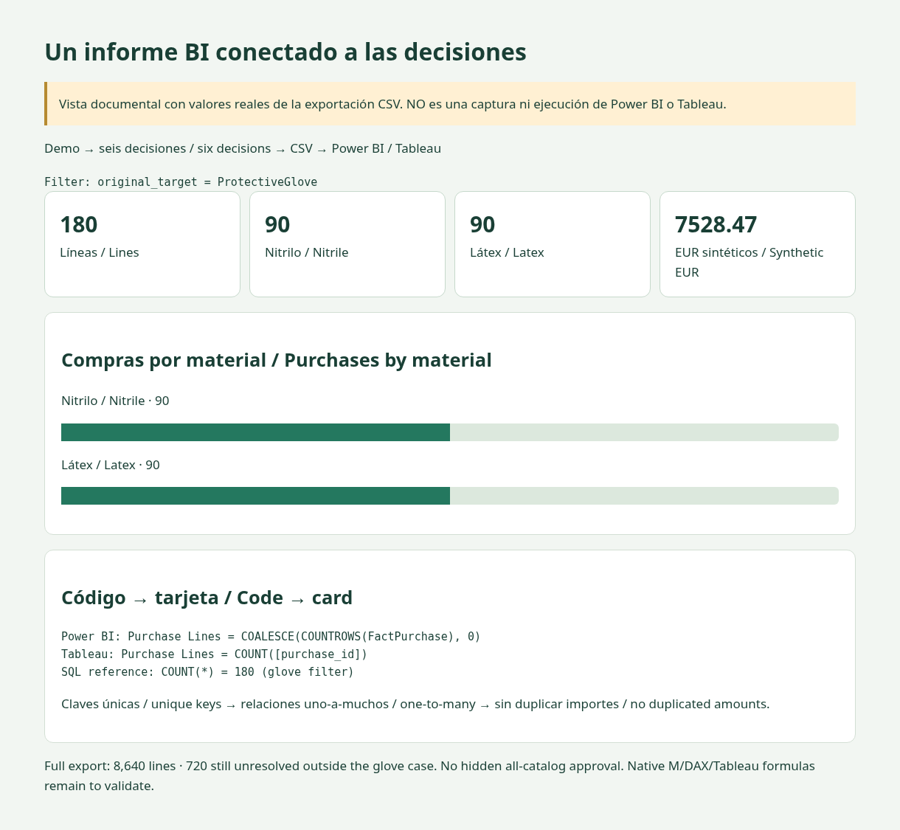

# Tableau · prepared, not natively validated / preparado, no validado de forma nativa

[Shared data model / Modelo común](../README.md) · [Saved expected result / Resultado esperado guardado](expected-output.json)

1. Connect to `../data/fact_purchase.csv`; set quantity/amount as whole numbers, IDs as strings. / Conectar al CSV y tipar importes/cantidades como enteros.
2. Add logical relationships (not a blind physical multi-table join): fact → mapping via mapping_id (many-to-one), mapping → supplier via supplier_id, mapping → category via category_id, fact → month via month. / Crear relaciones lógicas con las claves correctas.
3. Create fields from [calculations.txt](calculations.txt) individually. / Crear los campos individualmente.
4. Filter `original_target = ProtectiveGlove`. Cards: Purchase Lines, Amount EUR and Glove Pending Lines. Bars: material / COUNT(purchase_id). Detail: supplier, SKU, category. / Aplicar el mismo filtro de la demo.
5. Match **180 lines, 90 + 90, EUR 7,528.47 and zero glove pending lines**. Without that filter, pending lines are **720**. / Comprobar ambos alcances.

Expected results are derived from actual CSV/SQLite execution, **not Tableau execution**. Native field syntax, aggregation behavior, relationships and workbook interactions remain to validate. No `.twbx` or native screenshots are claimed. / Los cálculos esperados proceden de CSV/SQLite; todavía hay que validar el libro en Tableau.

Documentary layout with verified data / Diseño documental con datos comprobados

The layout is rendered from actual project CSV values; it is not a screenshot of the native BI tool. / No es una captura de la herramienta BI nativa.

