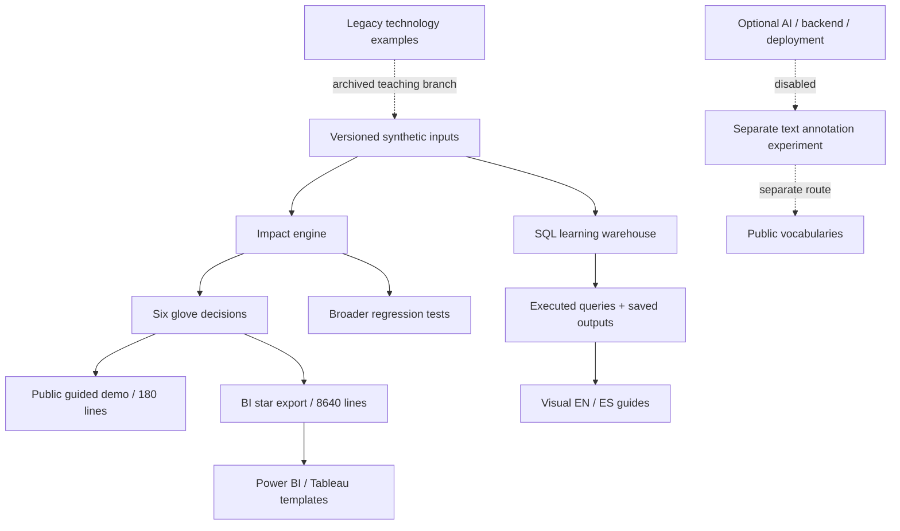

# Connection audit / Auditoría de conexiones

This is an explicit component map, not a claim that every folder runs in the public demo. / No todas las carpetas se ejecutan en la demo pública.

| Component / Componente | Actual link / Conexión real | State / Estado |
| --- | --- | --- |
| Public four-step case / Caso público | `glove-case.ts` → dashboard → exact scoped SQL | Active; 6 mappings / 180 lines / Activo |
| Full impact engine / Motor completo | Same source fixture; independent full-state SHACL tests | Regression scope; does not silently resolve all changes in the public route / Regresión separada |
| SQL levels / Niveles SQL | Same frozen JSON → normalized SQLite schema → queries → saved outputs | Locally executed; not a second procurement story / Ejecutado localmente |
| BI / Power BI / Tableau | Same six decisions → CSV star → checked totals → import formulas | CSV and reference totals executed; native reports pending / Nativo pendiente |
| Public vocabulary annotation / Anotación | Separate `?view=annotation` route and explicit source adapters | Separate experiment; does not change the frozen procurement fixture / Experimento separado |
| `06-examples` | Legacy synthetic disease-ranking examples by technology | Educational archive; not the current product / Archivo educativo |
| Optional AI, proxy, cloud / IA y despliegue | Explicit flags and templates | Disabled; not a production system / Desactivado |
| SNOMED / dictionary research | Rights-gated plans | No corpus or trained model / Sin corpus ni modelo |
| Historical unverified Excel | Provenance retained | Retired; no active redistribution / Retirado |

## What still needs work / Qué sigue pendiente

- Real company/catalog import and persistent shared review are not implemented. / Falta importar catálogos de empresa y compartir revisiones persistentes.
- Native Power BI/Tableau execution, interaction tests and service publication remain unvalidated. / Falta validación y publicación nativa de BI.
- BigQuery/Snowflake/Redshift are design templates only, not operational connections. / Son plantillas, no conexiones operativas.
- Shared legacy CSS still contains styles from earlier UI iterations; a CSS dependency cleanup is separate maintenance, not proof that all styles are used. / La hoja compartida conserva estilos antiguos; no se afirma que todos se usen.

Local workspace note: pre-existing file deletions were present when this documentation task began. They were not included in these commits or interpreted as intentional retirement. This map describes repository responsibilities, not a guarantee that an incomplete local checkout can run every old example. / Había borrados locales previos; no se han incluido ni tratado como retirada intencional de módulos.
