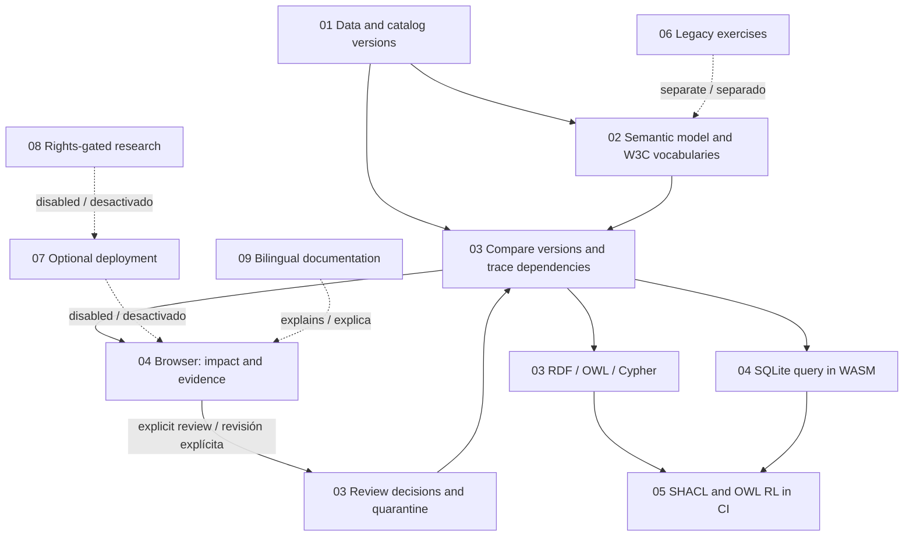

# Execution and dependencies / Ejecución y dependencias

1. **S01–S03:** load frozen fixtures, compare releases and traverse mappings to purchase records. / Cargar datos congelados, comparar versiones y recorrer correspondencias hasta las compras.
2. **S04:** a user explicitly applies a scenario review; split decisions use supplier material, and removed concepts are quarantined. / Aplicar revisión explícita; la división usa el material del proveedor y las bajas sin sustituto pasan a cuarentena.
3. **S05–S07:** recompute totals, execute SQLite and inspect the same facts in semantic formats. / Recalcular totales, ejecutar SQLite e inspeccionar los mismos hechos en formatos semánticos.
4. **S08:** CI validates all 8,640 records and 288 mappings per release state. The browser runs its own current-state checks; full SHACL and OWL RL run in Python. / CI valida todas las filas y correspondencias de cada estado. El navegador comprueba el estado actual; SHACL y OWL RL completos se ejecutan en Python.
5. **B01:** the secondary text workbench uses public vocabularies only on request. It does not change the frozen impact scenario. / El explorador de texto consulta vocabularios solo bajo petición; no altera el escenario congelado.

[Machine-readable stage map / Mapa de etapas](../03-pipelines/execution-map.json) · [Naming / Nombres](NAMING.md)
