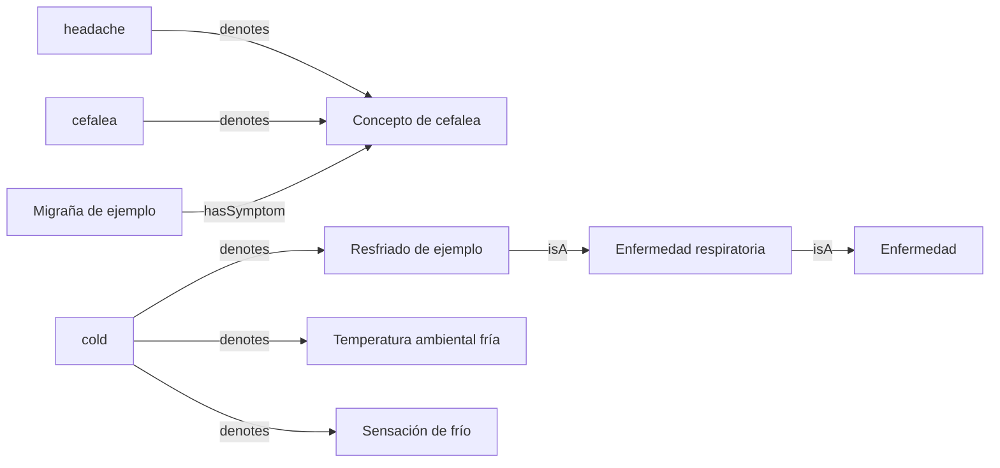

# Knowledge engineer: del lenguaje al grafo de conocimiento

[English](README.md) · [Español](README.es.md)

**[Probar demo →](https://beabustor.github.io/knowledge_engineer/)** · Disponible al activar GitHub Pages; instrucciones de publicación al final.

Ejemplo educativo para representar conocimiento médico y léxico en JSON,
Python, TypeScript, SQL, RDF/OWL y Neo4j, y recuperar enfermedades candidatas
a partir de descripciones en inglés o español. Requiere Python 3.10+ y, para
TypeScript, Node.js 22.18+. No es necesario instalar dependencias.

**El modelo clínico original y el caso de personas/acciones son sintéticos.**
El explorador añade un catálogo reducido de identificadores de referencia
CIE-10/ChEBI con etiquetas locales. No incluye contenidos de SNOMED CT ni
del diccionario María Moliner. Los resultados son candidatos educativos, no
diagnósticos ni probabilidades; no deben usarse para decisiones clínicas.

## Inicio rápido

Ejecutar desde la raíz del repositorio. `--lang` selecciona el idioma de salida;
la entrada puede estar en cualquiera de los dos idiomas. Por defecto se usa `es`.

```sh
python python/demo.py --lang en "I have fever, cough and sore throat"
python python/demo.py --lang es "Tengo cefalea y náuseas, pero sin fiebre"
node typescript/demo.ts --lang es "Cefalea y náuseas, pero sin fiebre"
python sql/demo.py --lang es "Cefalea y náuseas, pero sin fiebre"
```

Añadir `--json` para obtener resultados procesables. Las claves JSON, los IDs de
conceptos, los identificadores de código y las relaciones de base de datos se
mantienen en inglés para facilitar la interoperabilidad. Las etiquetas y las
explicaciones para personas se traducen. Los comentarios del código usan inglés.

## Tecnologías y carpetas

| Carpeta | Tecnología | Función |
| --- | --- | --- |
| `data/` | JSON | Conceptos sintéticos, asociaciones y términos bilingües comunes |
| `locales/` | JSON (`en`, `es`) | Etiquetas de conceptos y mensajes traducidos compartidos |
| `python/` | Python | Extracción léxica, ranking explicable y exportadores |
| `typescript/` | TypeScript / Node.js | Implementación independiente de extracción y ranking |
| `sql/` | SQL / SQLite | Modelo relacional, ranking por agregación y jerarquía recursiva |
| `rdf/` | RDF / RDFS / OWL (Turtle) | Representación semántica y restricciones de clases |
| `neo4j/` | Neo4j / Cypher | Importación del grafo de propiedades |

Node ejecuta TypeScript eliminando los tipos sin `npm install`; esto no realiza
un chequeo estático. SQLite usa la biblioteca estándar de Python y una base en
memoria. SQL reutiliza la extracción léxica de Python, pero calcula el ranking
en `sql/rank.sql` con parámetros enlazados. `sql/schema.sql` define las claves
foráneas; `sql/queries.sql` muestra ambigüedad e hiperonimia transitiva.

## Modelo de conocimiento



Los sinónimos y las traducciones apuntan a conceptos compartidos. La hiperonimia
conceptual se representa con `rdfs:subClassOf` / `IS_A`. Varios sentidos
representan ambigüedad léxica; esta estructura no distingue por sí sola homonimia
y polisemia. «Frío» tiene sentidos de temperatura ambiental y sensación corporal;
«cold» en inglés también tiene un sentido de enfermedad. Los términos ambiguos
se muestran y se excluyen de la evidencia de síntomas.

Los conceptos OWL son clases, no pacientes. `hasSymptom` usa restricciones
existenciales OWL; observar un síntoma no implica una enfermedad. El programa no
ejecuta un razonador OWL. Las asociaciones de síntomas son ilustrativas.

## Recuperación y limitaciones

Los ejemplos normalizan mayúsculas y acentos y buscan términos completos. La
negación simple usa `sin`, `no`, `niego`, `not`, `without`, `deny`, `denies` hasta
puntuación o contraste (`pero`, `aunque`, `but`, `however`). Cada síntoma
coincidente suma un punto; cada síntoma asociado explícitamente negado resta
dos. La salida incluye coincidencias, conflictos y síntomas no mencionados.
No mencionado no equivale a ausente. Las puntuaciones iguales son empates de evidencia.

La heurística no comprende temporalidad, gravedad, sujeto ni negación compleja:
«not only fever» / «no solo fiebre» es una limitación conocida. Se demuestra una
arquitectura explicable, no un método clínico validado. No se traduce la entrada
automáticamente: solo se reconocen términos del léxico compartido. Las pruebas
de equivalencia entre idiomas cubren los ejemplos incluidos, no lenguaje clínico
sin restricciones.

## Neo4j y RDF

Ejecutar `neo4j/knowledge.cypher` en Neo4j Browser o usar
`cypher-shell -f neo4j/knowledge.cypher` con la autenticación de la instancia.
No requiere APOC ni n10s. `MERGE` permite repetir el import con los mismos datos;
no elimina datos obsoletos tras cambios en el JSON. Los conceptos incluyen
`label_en` y `label_es`; `label` usa inglés por defecto. La identidad de cada
término incluye su idioma; ambos idiomas apuntan a los mismos nodos conceptuales.

```cypher
MATCH (d:KnowledgeDemo:Concept)-[:HAS_SYMPTOM]->(s:KnowledgeDemo:Concept)
RETURN d.label_es AS enfermedad, collect(s.label_es) AS sintomas;

MATCH (t:KnowledgeDemo:Term)-[:DENOTES]->(c:KnowledgeDemo:Concept)
WITH t, collect(c.label_es) AS sentidos WHERE size(sentidos) > 1
RETURN t.label, t.language, sentidos;
```

RDF incluye etiquetas conceptuales en ambos idiomas y etiquetas léxicas con su
idioma. Abrir `rdf/knowledge.ttl` en Protégé o cargarlo en un motor SPARQL:

```sparql
PREFIX ex: <https://example.org/knowledge-demo/>
PREFIX rdfs: <http://www.w3.org/2000/01/rdf-schema#>
PREFIX owl: <http://www.w3.org/2002/07/owl#>
SELECT ?disease ?label ?symptom WHERE {
  ?disease rdfs:label ?label ; rdfs:subClassOf ?restriction .
  FILTER(LANG(?label) = "es")
  ?restriction owl:onProperty ex:hasSymptom ; owl:someValuesFrom ?symptom .
}
```

SQL guarda traducciones en `concept_label(concept_id, language, label)` y sentidos
léxicos en `term_sense(term, language, concept_id)`. `rank.sql` recibe `:lang`
como parámetro enlazado. `concept.label` usa inglés por defecto.

## Validación y regeneración

```sh
PYTHONPATH=python python -m unittest discover -s python/tests -v
node --test typescript/demo.test.ts
python -m unittest discover -s sql -p 'test_*.py' -v
python python/demo.py --export /tmp/knowledge-example
cp /tmp/knowledge-example/knowledge.ttl rdf/knowledge.ttl
cp /tmp/knowledge-example/knowledge.cypher neo4j/knowledge.cypher
```

Las pruebas cubren recuperación, sinónimos, acentos, negación, ambigüedad, límites
de palabra, equivalencia bilingüe, paridad de claves de traducción, exports
repetibles e integridad SQL. No arrancan Neo4j ni un razonador OWL. Los exports
se guardan en el repositorio para inspeccionarlos sin instalar otras herramientas.

## Fuentes reales y mantenimiento de traducciones

Para SNOMED CT: obtener una edición autorizada y archivos RF2; importar conceptos
activos, descripciones por idioma y relaciones conservando IDs oficiales, edición
y procedencia. Los IDs `Example...` no son IDs SNOMED. No afirmar equivalencias
OWL sin verificar su significado.

Para María Moliner: usar una fuente autorizada de entradas, sentidos y relaciones,
conservando su procedencia sin copiar contenido protegido al repositorio.
Distinguir hiperonimia léxica de inclusión entre clases conceptuales. La
desambiguación contextual queda para una etapa futura; no hay conexión automática
a fuentes reales.

Mantener una implementación por tecnología y un conjunto común de IDs. Actualizar
juntos `locales/en.json` y `locales/es.json`; añadir términos y su idioma en
`data/knowledge.json`. Modificar ambos README en el mismo cambio, regenerar
exports y ejecutar todas las pruebas. No duplicar lógica por idioma humano.
El archivo LICENSE conserva el texto legal original.


## Demo interactiva en el navegador

`web/` contiene una aplicación adaptable a móvil, bilingüe, con descripciones
de ejemplo, tarjetas explicables de candidatos, nodos seleccionables y representaciones en pantalla
de RDF/OWL, Cypher y SQL. Importa el mismo motor puro (`typescript/core.ts`) que
la consola; no hay otra implementación de ranking para el navegador. El sitio
compilado incluye los datos sintéticos y las traducciones: no necesita API,
base de datos, fuentes externas, cuentas ni credenciales. Las descripciones
permanecen en memoria en el navegador; la aplicación no las transmite ni las
guarda. GitHub Pages sí sirve y registra las solicitudes normales del sitio.
Las representaciones en pantalla contienen ambos idiomas. No hay botones de descarga.

```sh
cd web
npm ci
npm run dev
# Compilación de producción, con chequeo estático TypeScript:
npm run build
npm run preview
```

Para probar en un navegador, compilar la aplicación y ejecutar desde la raíz
del repositorio. La prueba arranca y detiene su propio servidor en un puerto libre:

```sh
python -m pip install -r web/requirements-test.txt
python -m playwright install chromium
python web/test_browser.py
```

`CHROMIUM_PATH` permite seleccionar un Chromium existente. `DEMO_URL` cambia
el destino de las pruebas. Estas verifican ambos idiomas, selección de candidatos,
negación, ambigüedad, desbordamiento en móvil, representaciones en pantalla e invalidación
de resultados antiguos al editar la descripción.

### Publicar en GitHub Pages

1. Abrir **Settings → Pages → Build and deployment** del repositorio.
2. Seleccionar **Source: GitHub Actions** (requiere acceso de administración).
3. En **Actions → Validate and deploy demo**, pulsar **Run workflow** sobre `main`
   o subir un cambio a `main`.
4. Cuando el despliegue termine correctamente, abrir
   <https://beabustor.github.io/knowledge_engineer/>.

`.github/workflows/pages.yml` ejecuta pruebas Python, SQL, TypeScript y de
navegador, compila el sitio estático y despliega con el token temporal de GitHub.
Las solicitudes de cambios validan sin desplegar. No requiere secretos de
alojamiento ni servicios de pago para un repositorio público dentro de los límites
del plan gratuito aplicable. La configuración de Pages y la publicación correcta
se deben comprobar por separado: subir el workflow no demuestra que la web esté activa.


## Explorador de entidades, atributos, relaciones y acciones

La demo muestra todas las representaciones **en pantalla**, sin descargables:

- **Tipos de entidad:** Persona y Profesional sanitario.
- **Atributos:** Edad (entero) y Temperatura en Celsius (decimal), con dominio y rango.
- **Relaciones:** Realizada por y Tiene sujeto, como propiedades de objetos OWL.
- **Tipos de acción:** Acción y Medir temperatura.
- **Individuos:** una persona de 35 años, un profesional y una medición de 38.5 °C.

Las edades y mediciones son un caso fijo sintético, no datos extraídos del texto.
Seleccionar una tarjeta o un enlace cambia el grafo, RDF/Turtle, OWL/RDF/XML,
Neo4j/Cypher, SQL y el inspector inspirado en Protégé. Este último organiza
clases, atributos, relaciones e individuos; no ejecuta Protégé ni un razonador.
Neo4j y SQL muestran la representación, sin ejecutar consultas contra servidores.

`data/catalog.json` define los conceptos y `explorer/model.ts` genera las vistas.
Las pruebas comparan las tripletas RDF, OWL y SQL, además de probar la interfaz.

El catálogo clínico contiene solo tos (`R05`) y fiebre no especificada (`R50.9`)
de la edición **OMS CIE-10 2019**, no CIE-10-ES. El químico referencia aspirina
(`CHEBI:15365`), agua (`CHEBI:15377`) y etanol (`CHEBI:16236`). Son referencias
seleccionadas manualmente con enlaces a la fuente; no son una importación
completa ni una consulta en vivo. La versión ChEBI no está fijada. Etiquetas,
alias y jerarquías generales son editoriales locales. `rdfs:seeAlso` enlaza la
fuente sin afirmar `owl:equivalentClass`. Una mención negada se marca como tal;
no se transforma en evidencia positiva ni en una decisión de codificación.

Para ampliar a otros dominios, añadir conceptos, alias bilingües, tipo,
procedencia y relaciones al catálogo. Los dominios actuales son clínica, química
y modelado. No hay un reconocimiento universal ni inferencia de tratamientos.
