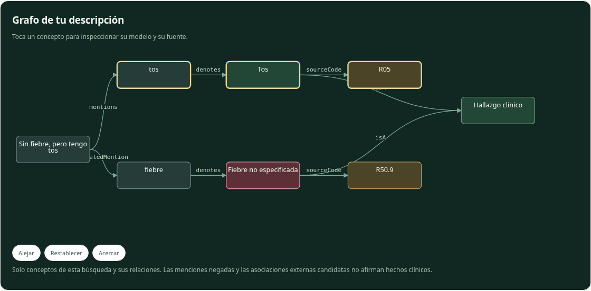
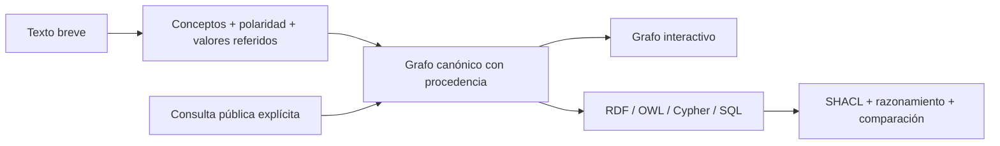

# Knowledge Engineer — del texto al grafo trazable

[English](README.md) · [Español](README.es.md) · **[Probar la demo](https://beabustor.github.io/knowledge_engineer/)**

Portfolio bilingüe de **Knowledge / Ontology Engineering**: reconocer conceptos
en descripciones breves, conservar evidencia/procedencia y examinar el mismo
conocimiento como grafo, RDF, OWL, Cypher y SQL. Sin diagnóstico ni codificación clínica automática.



## Pruébalo en un minuto

1. Abre la demo: ya muestra un grafo de ejemplo. Edita la frase (máximo **100 caracteres**).
2. Examina el grafo: menciones, negación, conceptos e identificadores.
3. Selecciona un concepto para ver su fuente y sus representaciones.
4. Opcionalmente consulta Wikidata / ChEBI / HPO / NLM / CIMA con un término breve separado; los enlaces son
   **candidatos sin verificar**, no equivalencias ontológicas.

La demo funciona en tu navegador, sin necesitar IA de pago ni desplegar cloud.
El catálogo es pequeño deliberadamente: [textos propios, referencias y derechos](data/registry.json).

### Revisa anotaciones de fuentes públicas

Conecta **Wikidata, ChEBI, HPO, OLS, NLM ICD-10-CM y CIMA** desde la demo. Elige un fragmento y un término de búsqueda; acepta o rechaza anotaciones candidatas. El grafo y las representaciones conservan revisión, evidencia y fuente. Las etiquetas SKOS y la procedencia PROV-O se generan localmente. **ICD-10-CM es la adaptación estadounidense en inglés**, no CIE-10-ES. Sin claves API ni IA de pago; con límites conjuntos. [Flujo, endpoints y derechos](docs/es/sources.md#servicios-públicos-conectados).

Las pestañas muestran usos del mismo modelo revisado: RDF para intercambio, OWL para semántica ontológica, Cypher para bases de grafos y SQL para integración relacional. Previsualizar Cypher no ejecuta Neo4j. La validación actual se ejecuta en CI; ver código no demuestra un despliegue de producción.

### Preguntas guiadas

Debajo del grafo de entrada, inicia una entrevista educativa: responde **sí / no / no sé** a un máximo de cinco preguntas, corrige respuestas e inspecciona el grafo y las representaciones actualizados. Tres patrones propios muestran rasgos presentes, ausentes y pendientes con enlaces a categorías CIE-10. Son **ejemplos, no reglas diagnósticas validadas**; no se asignan ni descartan enfermedades. La evaluación de extracción no evalúa esta entrevista. Los catálogos abiertos CIE-10 aportan códigos y etiquetas; inferir enfermedades de forma fiable requiere además un modelo de decisión clínica validado.

## Qué demuestra el proyecto

- Separación de **clases, individuos, propiedades de datos y propiedades de objetos**.
- Modelo canónico que genera representaciones interoperables, con isomorfismo
  RDF/OWL y comparación de ida/vuelta SQLite.
- Validación SHACL, ejemplos inválidos que deben fallar y razonamiento OWL RL limitado.
- Reglas explícitas, procedencia, abstención y análisis honesto de errores.
- Aislamiento de estado asíncrono, cuotas e integración probada de servicios públicos.

La aportación del portfolio es el modelo, las transformaciones, gestión de estado,
adaptadores, evaluación, validación y entrega del repositorio. No afirma un LLM
propio, una plataforma Kubernetes de producción ni experiencia clínica.

## Evidencia medida

| Comprobación | Resultado observado | Evidencia |
| --- | --- | --- |
| Extracción de concepto y polaridad | **81,3 % F1 micro**, 79,2 % de casos exactos | [Informe de 48 casos](evaluation/report.json) |
| Recuperación de candidatos | **95,7 % recall@5**; orden de catálogo, sin ranker aprendido | [Protocolo](evaluation/README.md) |
| Negación / abstención | 84,1 % / 90,0 %, con denominadores acotados | [Errores y recuentos](evaluation/report.json) |
| Perfil semántico | Grafo válido; **4 ejemplos inválidos rechazados** | [Informe SHACL y OWL RL](semantic/report.json) |
| Terminología en vivo | Los seis conectores devolvieron identificadores reales esperados | [Evidencia HTTP fechada](tests/integration/live-report.json) |
| Navegador | Grafo/evidencia bilingües, descargas, cuotas, móvil y reinicio | [Prueba de aceptación](web/test_browser.py) |

**Límites:** 60 frases sintéticas propias: 12 de desarrollo y 48 de prueba
congeladas. Etiquetas del autor, **revisión terminológica independiente pendiente**;
no es un benchmark clínico. No se retocaron reglas/alias para pasar los fallos.
Falla en negación posterior, «no solo» y erratas. Los resultados describen una
tarea acotada, no comprensión clínica general. La latencia es local, no un SLA.

## Ejecutar y verificar

Requiere Node.js 24 y Python 3.10+.

```sh
cd web
npm ci
npm run dev
```

Desde la raíz:

```sh
npm run build --prefix web
python -m pip install -r web/requirements-test.txt
python -m playwright install chromium
python web/test_browser.py
python -m unittest discover -s explorer -p 'test_*.py' -v
python semantic/validate.py
node evaluation/run.ts
```

CI comprueba implementación y representaciones; el benchmark registra errores,
no se fuerza al 100 %. La verificación real de fuentes es optativa:
`python tests/integration/live_sources.py`. Falla sin red en vez de sustituir la
prueba real por simulaciones. [Comandos completos y despliegue](docs/es/technical-guide.md).

## Arquitectura y alcance



[Decisiones y matriz de capacidades](docs/es/architecture.md) ·
[Evaluación y hoja de revisión](evaluation/README.md) ·
[Validación semántica](semantic/README.md) ·
[Fuentes y licencias](docs/es/sources.md) ·
[Hoja de ruta](docs/es/roadmap.md)

`optional/`, `infrastructure/` y `research/` contienen bases/planes desactivados,
no capacidades de producción demostradas. Los ejercicios CLI antiguos de
puntuación de enfermedades quedan fuera de la demo y de esta evaluación.

## Privacidad, cuotas y derechos

El análisis local no envía la descripción. La consulta pública explícita envía
su término e IP de conexión a la fuente. Pages aplica una **cuota evitable de
6/minuto y 30/24h por navegador**; el proxy opcional por IP no está desplegado.

Código/textos propios del catálogo: MIT. Frases de evaluación: CC0-1.0.
Resultados externos: condiciones de cada fuente. El Excel sin derechos verificados
se retiró de la versión actual y de futuros artefactos web; **sigue en commits
antiguos**. No se reescribió el historial. No se incluyen ni entrenan contenidos
SNOMED CT o María Moliner. [Registro de derechos](data/registry.json).
