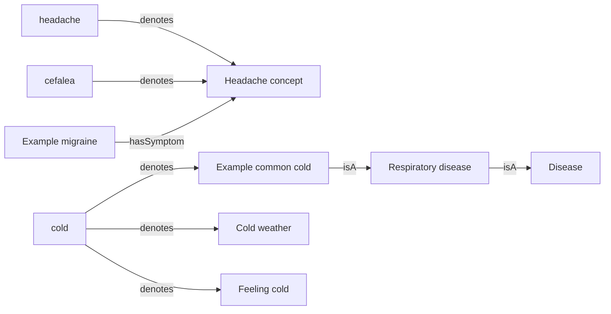

# Knowledge engineer: from language to knowledge graphs

[English](README.md) · [Español](README.es.md)

**[Try demo →](https://beabustor.github.io/knowledge_engineer/)** · Available after GitHub Pages is enabled; see deployment instructions below.

Educational example of representing medical and lexical knowledge in JSON,
Python, TypeScript, SQL, RDF/OWL and Neo4j, then retrieving candidate diseases
from English or Spanish descriptions. Requires Python 3.10+; TypeScript examples
require Node.js 22.18+. Neither example requires dependency installation.

**All data is synthetic.** No SNOMED CT or María Moliner dictionary content is
included. Results are educational candidates, not diagnoses or probabilities;
do not use them for clinical decisions.

## Quick start

Run from the repository root. `--lang` selects the output language; the input
can use either language. The default output language is Spanish (`es`).

```sh
python python/demo.py --lang en "I have fever, cough and sore throat"
python python/demo.py --lang es "Tengo cefalea y náuseas, pero sin fiebre"
node typescript/demo.ts --lang en "Headache and nausea, but without fever"
python sql/demo.py --lang en "Headache and nausea, but without fever"
```

Append `--json` for machine-readable results. JSON keys, concept IDs, code
identifiers and database relationship names stay in English for interoperability;
labels and human-readable explanations are localized. Code comments use English.

## Technologies and layout

| Folder | Technology | Purpose |
| --- | --- | --- |
| `data/` | JSON | Shared synthetic concepts, associations and bilingual terms |
| `locales/` | JSON (`en`, `es`) | Shared translated concept labels and application messages |
| `python/` | Python | Lexical extraction, explainable ranking and exports |
| `typescript/` | TypeScript / Node.js | Independent extraction and ranking implementation |
| `sql/` | SQL / SQLite | Relational model, aggregate ranking and recursive hierarchy |
| `rdf/` | RDF / RDFS / OWL (Turtle) | Semantic representation and class restrictions |
| `neo4j/` | Neo4j / Cypher | Property graph import |

Node's native type stripping executes TypeScript without `npm install`; it does
not perform static type checking. SQLite uses Python's standard library and an
in-memory database. SQL reuses Python's lexical extraction, but performs ranking
in `sql/rank.sql` with bound parameters. `sql/schema.sql` defines foreign keys;
`sql/queries.sql` demonstrates ambiguity and transitive hypernymy.

## Knowledge model



Synonyms and translations point to shared concepts. Conceptual hypernymy is
represented as `rdfs:subClassOf` / `IS_A`. Multiple senses represent lexical
ambiguity; this structure alone does not distinguish homonymy from polysemy.
Spanish “frío” has weather and bodily-sensation senses; English “cold” also has
a disease sense. Ambiguous terms are reported and excluded from symptom evidence.

OWL concepts are classes, not patients. `hasSymptom` uses existential OWL
restrictions; observing a symptom does not entail a disease. The program does
not run an OWL reasoner. All symptom associations are illustrative.

## Retrieval and limitations

The examples normalize case and accents and match whole terms. Simple negation
uses `sin`, `no`, `niego`, `not`, `without`, `deny`, `denies` until punctuation or
contrast (`pero`, `aunque`, `but`, `however`). Each matching symptom adds one
point; each associated explicitly negated symptom subtracts two. Output includes
matches, conflicts and unmentioned symptoms. Unmentioned is not equivalent to
absent. Equal scores represent ties in evidence.

The heuristic does not understand temporal context, severity, experiencer or
complex negation: “not only fever” / “no solo fiebre” is a known limitation.
These examples demonstrate an explainable architecture, not a validated clinical
method. Input is not automatically translated; only terms in the shared lexicon
are recognized. Cross-language equivalence tests cover the included examples,
not unrestricted clinical language.

## Neo4j and RDF

Run `neo4j/knowledge.cypher` in Neo4j Browser, or use
`cypher-shell -f neo4j/knowledge.cypher` with your instance's authentication.
No APOC or n10s is required. `MERGE` makes imports repeatable for the same data;
it does not remove stale data after changes to JSON. Concept properties include
`label_en` and `label_es`; `label` defaults to English. Term identity includes
its language, and both languages point to the same concept nodes.

```cypher
MATCH (d:KnowledgeDemo:Concept)-[:HAS_SYMPTOM]->(s:KnowledgeDemo:Concept)
RETURN d.label_en AS disease, collect(s.label_en) AS symptoms;

MATCH (t:KnowledgeDemo:Term)-[:DENOTES]->(c:KnowledgeDemo:Concept)
WITH t, collect(c.label_en) AS senses WHERE size(senses) > 1
RETURN t.label, t.language, senses;
```

RDF has concept labels in both languages, and lexical labels tagged with their
language. Open `rdf/knowledge.ttl` in Protégé or load it into a SPARQL engine:

```sparql
PREFIX ex: <https://example.org/knowledge-demo/>
PREFIX rdfs: <http://www.w3.org/2000/01/rdf-schema#>
PREFIX owl: <http://www.w3.org/2002/07/owl#>
SELECT ?disease ?label ?symptom WHERE {
  ?disease rdfs:label ?label ; rdfs:subClassOf ?restriction .
  FILTER(LANG(?label) = "en")
  ?restriction owl:onProperty ex:hasSymptom ; owl:someValuesFrom ?symptom .
}
```

SQL stores translations in `concept_label(concept_id, language, label)` and
lexical senses in `term_sense(term, language, concept_id)`. `rank.sql` accepts
`:lang` as a bound parameter. `concept.label` defaults to English.

## Validation and regeneration

```sh
PYTHONPATH=python python -m unittest discover -s python/tests -v
node --test typescript/demo.test.ts
python -m unittest discover -s sql -p 'test_*.py' -v
python python/demo.py --export /tmp/knowledge-example
cp /tmp/knowledge-example/knowledge.ttl rdf/knowledge.ttl
cp /tmp/knowledge-example/knowledge.cypher neo4j/knowledge.cypher
```

Tests cover retrieval, synonyms, accents, negation, ambiguity, word boundaries,
bilingual equivalence, locale key parity, repeatable exports and SQL integrity.
They do not start Neo4j or an OWL reasoner. Generated exports are committed for
inspection without installing additional tools.

## Real sources and translation maintenance

For SNOMED CT, obtain an authorized edition and RF2 files; import active concepts,
language descriptions and relationships, retaining official IDs, edition and
provenance. `Example...` IDs are not SNOMED IDs. Do not assert OWL equivalence
without checking meaning.

For María Moliner, use an authorized source for entries, senses and relationships
and retain provenance without copying protected content into this repository.
Distinguish lexical hypernymy from conceptual class inclusion. Contextual
sense disambiguation is future work; real sources are not connected automatically.

Keep one implementation per technology and one shared set of concept IDs. Update
`locales/en.json` and `locales/es.json` together; add terms and their language in
`data/knowledge.json`. Update both READMEs in the same change, regenerate exports
and run all tests. Do not duplicate program logic per human language. The LICENSE
file retains the original legal text.


## Interactive browser demo

`web/` contains a responsive, bilingual application with example descriptions,
explainable candidate cards, selectable graph nodes, and RDF/OWL, Cypher and JSON
downloads. It imports the same pure engine (`typescript/core.ts`) as the CLI;
there is no separate browser ranking implementation. The compiled site bundles
the synthetic dataset and translations, so analysis requires no API, database,
external font, account or credential. Descriptions stay in memory in the browser;
the application does not transmit them or store them. GitHub Pages still serves
and logs ordinary site requests. Downloads contain the full bilingual graph;
JSON contains the current analysis.

```sh
cd web
npm ci
npm run dev
# Production build, including static TypeScript checking:
npm run build
npm run preview
```

For browser tests, build the app, serve `web/dist` on port 4173, and in another
terminal run from the repository root:

```sh
python -m pip install -r web/requirements-test.txt
python -m playwright install chromium
python web/test_browser.py
```

An existing Chromium can be selected with `CHROMIUM_PATH`. `DEMO_URL` overrides
the test target. Tests exercise both languages, candidate selection, negation,
ambiguity, mobile overflow, download contents and invalidation of stale results.

### Publish to GitHub Pages

1. Open repository **Settings → Pages → Build and deployment**.
2. Set **Source** to **GitHub Actions** (requires repository administration access).
3. In **Actions → Validate and deploy demo**, use **Run workflow** on `main`, or
   push a change to `main`.
4. After the deployment succeeds, open
   <https://beabustor.github.io/knowledge_engineer/>.

`.github/workflows/pages.yml` runs the Python, SQL, TypeScript and browser tests,
builds the static site, and deploys using GitHub's short-lived workflow token.
Pull requests validate without deployment. No hosting secret or paid service is
required for a public repository under GitHub's applicable free-plan limits.
Pages settings and successful publication must be checked separately from a Git
push; a committed workflow alone does not establish that the site is live.
