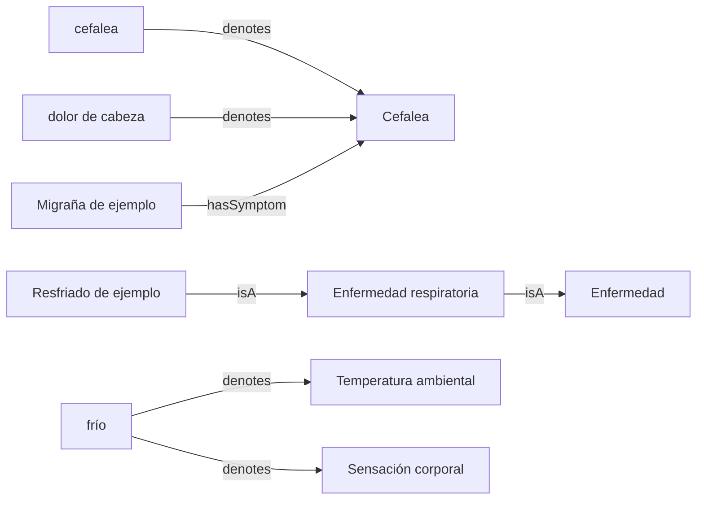

# Knowledge engineer: del lenguaje al grafo

Ejemplo educativo para representar conocimiento médico y léxico en JSON,
RDF/OWL y Neo4j, y recuperar enfermedades candidatas desde una descripción.
Python 3.10+, sin dependencias externas para ejecutar la demostración.

```sh
python python/demo.py "Tengo fiebre, tos y dolor de garganta"
python python/demo.py "Tengo cefalea y náuseas, pero sin fiebre"
PYTHONPATH=python python -m unittest discover -s python/tests -v
python python/demo.py --export /tmp/knowledge-example
```

**Los datos son sintéticos.** No contienen extractos de SNOMED CT ni del
Diccionario de uso del español de María Moliner. Los resultados no son un
diagnóstico ni probabilidades y no sirven para tomar decisiones clínicas.

## Un conocimiento, varias representaciones

- `data/knowledge.json`: conceptos, términos y asociaciones legibles.
- `rdf/knowledge.ttl`: RDF en Turtle con clases y restricciones OWL.
- `neo4j/knowledge.cypher`: grafo de propiedades para Neo4j.
- `python/demo.py`: recuperación explicable desde texto español.



Los sinónimos designan un mismo concepto. La hiperonimia conceptual se
representa mediante `rdfs:subClassOf` / `IS_A`. Para la ambigüedad léxica, un
mismo término designa varios sentidos. Esta estructura permite representar
homonimia y polisemia, pero no distingue por sí sola ambos fenómenos.
«Frío» se conserva como ambiguo: no se usa automáticamente como síntoma.

Los conceptos OWL son clases, no pacientes. `hasSymptom` se representa con
restricciones existenciales OWL; estas no implican que observar un síntoma
permita deducir una enfermedad. El programa no ejecuta un razonador OWL.
La asociación de síntomas es exclusivamente didáctica.

## Cómo recupera candidatos

Normaliza acentos y mayúsculas y busca términos completos. Detecta negación
simple (`sin`, `no`, `niego`) hasta puntuación o contraste (`pero`, `aunque`).
Cada síntoma coincidente suma un punto y cada síntoma negado asociado resta
dos. Muestra coincidencias, conflictos y síntomas no mencionados; estos últimos
no se consideran ausentes. Los empates en puntuación son empates de evidencia.

Es una heurística limitada: no interpreta temporalidad, gravedad, sujetos ni
negación compleja. Por ejemplo, «no solo tengo fiebre» requiere un análisis
lingüístico que este ejemplo no implementa. El objetivo es mostrar una
arquitectura explicable, no validar un método clínico.

## Neo4j

Con una instancia Neo4j disponible, ejecutar `neo4j/knowledge.cypher` desde
Neo4j Browser o con `cypher-shell -f neo4j/knowledge.cypher`, usando la
autenticación configurada para esa instancia. No requiere APOC ni n10s.
El import usa `MERGE` y puede repetirse para estos mismos datos.
No elimina datos antiguos si después se modifica el JSON.

```cypher
MATCH (d:KnowledgeDemo:Concept)-[:HAS_SYMPTOM]->(s:KnowledgeDemo:Concept)
RETURN d.label AS enfermedad, collect(s.label) AS sintomas;

MATCH (t:KnowledgeDemo:Term)-[:DENOTES]->(c:KnowledgeDemo:Concept)
WITH t, collect(c.label) AS sentidos WHERE size(sentidos) > 1
RETURN t.label, sentidos;
```

El RDF se puede abrir en Protégé o cargar en un motor SPARQL. Por ejemplo:

```sparql
PREFIX ex: <https://example.org/knowledge-demo/>
PREFIX rdfs: <http://www.w3.org/2000/01/rdf-schema#>
PREFIX owl: <http://www.w3.org/2002/07/owl#>
SELECT ?disease ?symptom WHERE {
  ?disease rdfs:subClassOf ?restriction .
  ?restriction owl:onProperty ex:hasSymptom ; owl:someValuesFrom ?symptom .
}
```

## Integrar las fuentes reales

Para SNOMED CT: obtener una edición autorizada y sus archivos RF2; importar
conceptos activos, descripciones españolas y relaciones conservando IDs,
edición y procedencia. Los IDs `Example...` de este repositorio no son IDs
SNOMED. No afirmar equivalencias OWL sin verificar el significado.

Para María Moliner: disponer de una fuente autorizada e importar entradas,
sentidos y relaciones con su procedencia, sin copiar contenido protegido al
repositorio. Distinguir hiperonimia entre sentidos léxicos de inclusión entre
clases conceptuales. La desambiguación contextual será una etapa adicional.

## Validación

Las pruebas cubren recuperación, sinónimos, acentos, negación, ambigüedad,
límites de palabra y generación repetible de exports. El servidor Neo4j y un
razonador OWL no se ejecutan como parte de esas pruebas. Los archivos generados
se incluyen para inspeccionar e importar el ejemplo sin instalar herramientas.

## Carpetas por tecnología

| Carpeta | Tecnología | Función |
| --- | --- | --- |
| `data/` | JSON | Fuente común de datos sintéticos |
| `python/` | Python | Extracción léxica, ranking explicable y exportadores |
| `typescript/` | TypeScript / Node.js | Implementación independiente de extracción y ranking |
| `sql/` | SQL / SQLite | Modelo relacional, ranking mediante agregación y jerarquía recursiva |
| `rdf/` | RDF / RDFS / OWL (Turtle) | Representación semántica y restricciones de clases |
| `neo4j/` | Neo4j / Cypher | Importación del grafo de propiedades |

TypeScript se ejecuta con Node.js **22.18+** mediante su soporte nativo para
eliminar anotaciones de tipos; esto no sustituye un chequeo estático con `tsc`.
No necesita `npm install`. SQL utiliza SQLite incluido en Python y una base
en memoria: no requiere instalar un servidor. Reutiliza el análisis léxico de
Python, pero calcula el ranking con `sql/rank.sql` y parámetros enlazados.

```sh
node typescript/demo.ts "Tengo cefalea y náuseas, pero sin fiebre"
node --test typescript/demo.test.ts
python sql/demo.py "Tengo cefalea y náuseas, pero sin fiebre"
python -m unittest discover -s sql -p 'test_*.py' -v
```

`sql/schema.sql` define tablas y claves foráneas; `sql/queries.sql` muestra
ambigüedad e hiperonimia transitiva. Las pruebas SQL comprueban integridad,
importación repetida y equivalencia del ranking con Python.

Para actualizar los exports después de modificar los datos:

```sh
python python/demo.py --export /tmp/knowledge-example
cp /tmp/knowledge-example/knowledge.ttl rdf/knowledge.ttl
cp /tmp/knowledge-example/knowledge.cypher neo4j/knowledge.cypher
```

El JSON es la fuente compartida. Las representaciones no incorporan datos
reales de SNOMED CT o María Moliner ni conexión automática a sus fuentes.
