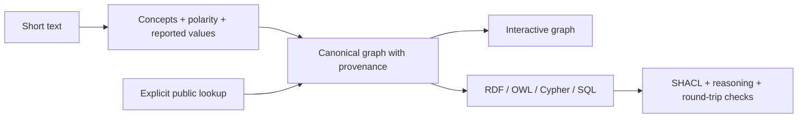

# Knowledge Engineer — text to traceable graphs

[English](README.md) · [Español](README.es.md) · **[Try the demo](https://beabustor.github.io/knowledge_engineer/)**

A bilingual **Knowledge / Ontology Engineering portfolio**: identify concepts in
short descriptions, preserve evidence and provenance, and inspect the same
knowledge as a graph, RDF, OWL, Cypher and SQL. No diagnosis or automatic clinical coding.


## Try it in one minute

1. Open the demo: a live example graph is already visible. Edit the sentence (maximum **100 characters**).
2. Inspect the query-generated graph: mentions, negation, concepts and identifiers.
3. Select a concept to see its source and technical representations.
4. Optionally query Wikidata / ChEBI / HPO / NLM / CIMA with a separate short term; external links remain
   **unverified candidates**, not ontology equivalence.

The demo runs locally in your browser. Paid AI and cloud deployment are not required.
The catalog is deliberately small: [authored labels, reference IDs and rights](data/registry.json).

### Review public-source annotations

Connect **Wikidata, ChEBI, HPO, OLS, NLM ICD-10-CM and CIMA** directly in the demo. Choose a text fragment and search term, then accept or reject candidate annotations. The graph and all representations preserve your review, evidence and source. SKOS labels and PROV-O provenance are generated locally. **ICD-10-CM is the US adaptation, in English**, not Spanish CIE-10-ES. No API keys or paid AI; shared limits apply. [Workflow, endpoints and rights](docs/en/sources.md#connected-public-services).

The technical tabs demonstrate different uses of one reviewed model: RDF for interchange, OWL for ontology semantics, Cypher for graph databases and SQL for relational integration. A Cypher preview does not execute Neo4j. Current validation is in CI; on-screen code is not proof of production deployment.

### Guided questions

Below the input graph, start an educational interview: answer **yes / no / unknown** to up to five questions, correct answers, and inspect the updated graph and representations. Three authored patterns show supporting, absent and unresolved features with ICD-10 category links. These are **illustrative patterns, not validated diagnostic rules**; no disease is assigned or ruled out. The extraction benchmark below does not evaluate this interview. Open ICD-10 catalogs provide codes and labels; a validated clinical decision model would be needed for reliable disease inference.

## What this project demonstrates

- Separation of **classes, individuals, datatype properties and object properties**.
- A canonical model generating interoperable representations, with RDF/OWL graph
  isomorphism and SQLite round-trip checks.
- SHACL validation, failing negative fixtures and limited OWL RL reasoning.
- Explicit lexical rules, provenance, abstention and honest failure analysis.
- Async-state isolation, source quotas and tested public-service integration.

The portfolio contribution is the model, transformation pipeline, state management,
source adapters, evaluation, validation and delivery workflow in this repository.
It does not claim a custom LLM, a deployed Kubernetes platform or clinical expertise.

## Measured evidence

| Check | Observed result | Evidence |
| --- | --- | --- |
| Concept + polarity extraction | **81.3% micro F1**, 79.2% exact-case accuracy | [48-case report](evaluation/report.json) |
| Candidate retrieval | **95.7% recall@5**; catalog order, no learned ranker | [Protocol](evaluation/README.md) |
| Negation / abstention | 84.1% / 90.0%, with scoped denominators | [Errors and counts](evaluation/report.json) |
| Semantic profile | Valid graph; **4 invalid fixtures rejected** | [SHACL + OWL RL report](semantic/report.json) |
| Live terminology | All six search connectors returned expected real identifiers | [Timestamped live HTTP evidence](tests/integration/live-report.json) |
| Browser behavior | Bilingual graph/evidence, downloads, quotas, mobile and reset | [Acceptance test](web/test_browser.py) |

**Evaluation limits:** 60 original synthetic phrases: 12 development + 48 frozen
test cases. Author-labeled, **independent terminology review pending**, not a clinical
benchmark. There was no alias/rule tuning to fix test failures. Known failures
include post-negation, “not only” and typos. Results demonstrate this bounded task,
not general medical language understanding. Latency measurements are local, not an SLA.

## Run and verify

Requires Node.js 24 and Python 3.10+.

```sh
cd web
npm ci
npm run dev
```

From the repository root:

```sh
npm run build --prefix web
python -m pip install -r web/requirements-test.txt
python -m playwright install chromium
python web/test_browser.py
python -m unittest discover -s explorer -p 'test_*.py' -v
python semantic/validate.py
node evaluation/run.ts
```

CI checks implementation and representations; the benchmark also records failures,
it is not forced to 100%. Real-source verification is a separate opt-in command:
`python tests/integration/live_sources.py`. It fails without network access instead
of replacing real evidence with fixtures. [Full commands and deployment](docs/en/technical-guide.md).

## Architecture and scope



[Engineering decisions and capability matrix](docs/en/architecture.md) ·
[Evaluation and review sheet](evaluation/README.md) ·
[Semantic validation](semantic/README.md) ·
[Sources and licenses](docs/en/sources.md) ·
[Scoped roadmap](docs/en/roadmap.md)

`optional/`, `infrastructure/` and `research/` contain disabled scaffolds/plans,
not demonstrated production capabilities. Legacy synthetic disease CLI exercises
remain outside the demo and evaluation. See the roadmap before judging them as delivered.

## Privacy, quotas and rights

Local analysis sends no description. An explicit public lookup sends its term and
connection IP to the source. Pages applies a **bypassable browser quota of 6/minute
and 30/24h**; the optional peer-IP proxy is not publicly deployed.

Project-authored code/catalog text: MIT. Synthetic evaluation cases: CC0-1.0.
External results retain source-specific terms. The unverified third-party Excel
was removed from the current tree and future site artifacts; **older Git history
still contains it**. No history rewrite was performed. SNOMED CT and María Moliner
content is not bundled or used for training. [Detailed rights register](data/registry.json).
