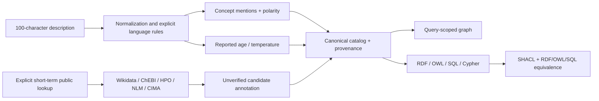

# Architecture and engineering decisions

[Español](../es/architecture.md)

- **One representation model:** `explorer/model.ts` generates all technical views
  from the same concepts. Graphs are derived from the current query, not an LLM's
  invented ontology. `provenanceKind` separates local, reference, reported and remote.
- **Class vs individual:** Person is a class; SamplePerson is a named individual.
  Age is a datatype property; performedBy is an object property. Actions are
  modeled as classes with explicit instances, not conflated with attributes.
- **Lexical matching is not equivalence:** a phrase denotes a local candidate.
  `rdfs:seeAlso` links to a reference, while `candidateMatch` is an annotation.
  Neither asserts `owl:sameAs` or `owl:equivalentClass`.
- **OWL limits:** the supported profile is verified with SHACL and OWL RL checks,
  not OWL DL certification, exhaustive consistency proof or clinical reasoning.
- **State ownership:** changing text resets matches, selection, graph and remote
  candidates. Request-generation IDs reject late responses. Provider caches and
  quota timestamps survive only as shared resources, not evidence for a new query.
- **Privacy and spending:** local analysis sends no description to a service.
  An explicit separate lookup sends a short term to Wikidata/ChEBI/HPO/OLS/NLM/CIMA. Browser quotas are
  bypassable; the optional server has single-process peer-IP/global quotas.
  No API key, paid AI or training dependency is in the browser bundle.
- **Deliberate simplicity:** no graph database is required to inspect this small
  catalog. Cypher is a generated representation, not proof of a tested Neo4j server.
  Adding Kubernetes or a model would not fix missing terminology/evaluation.

## Implemented versus planned

| Component | Evidence | State |
| --- | --- | --- |
| Browser graph, evidence, bilingual UI | Browser acceptance tests | Implemented |
| RDF/OWL/SQL generation | Graph-isomorphism and SQL checks | Implemented |
| SHACL + limited OWL RL reasoning | `semantic/report.json` | Implemented |
| Local rule-based extraction | Frozen author benchmark | Implemented, limited |
| Wikidata/ChEBI/HPO/OLS/NLM/CIMA HTTP integration | Timestamped live report + fixture tests | Verified for reported run |
| Public backend/IP quotas | Unit tests | Optional; not publicly deployed |
| Neo4j server | No execution evidence | Not validated |
| AI, cloud infrastructure, bulk workers | Gates, tests and templates | Optional scaffolds, not production |
| SNOMED/dictionary training | Rights-gated research plans | Not implemented |
