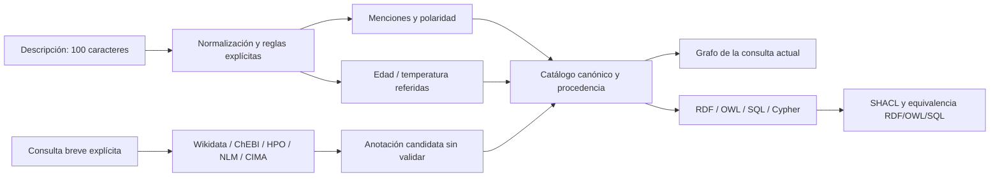

# Arquitectura y decisiones de ingeniería

[English](../en/architecture.md)

- **Un modelo de representación:** `explorer/model.ts` genera las vistas con los
  mismos conceptos. El grafo deriva de la consulta, no de una ontología inventada
  por un LLM. `provenanceKind` distingue local, referencia, referido y remoto.
- **Clases e individuos:** Persona es clase; SamplePerson, individuo. Edad es una
  propiedad de datos; realizadaPor, una propiedad de objetos. Las acciones tienen
  tipos e instancias explícitos; no se confunden con atributos.
- **Coincidencia no es equivalencia:** una expresión propone un concepto local.
  `rdfs:seeAlso` enlaza la referencia; `candidateMatch` es una anotación. Ninguna
  afirma `owl:sameAs` o `owl:equivalentClass`.
- **Límites OWL:** perfil probado con SHACL y comprobaciones OWL RL, sin certificación
  OWL DL, prueba exhaustiva de consistencia ni razonamiento clínico.
- **Estado:** cambiar el texto limpia resultados, selección, grafo y candidatos.
  Generaciones de peticiones descartan respuestas tardías. Caché/cuotas son recursos
  compartidos; no cuentan como evidencia para otra búsqueda.
- **Privacidad y costes:** el análisis local no envía la descripción. La consulta
  explícita independiente envía un término breve a Wikidata/ChEBI/HPO/OLS/NLM/CIMA. Las cuotas de navegador
  son evitables; el servidor opcional añade cuotas por IP/globales de proceso único.
  No se incluye IA de pago, claves ni entrenamiento en el bundle.
- **Simplicidad deliberada:** no hace falta una base de grafos para inspeccionar el
  catálogo pequeño. Generar Cypher no demuestra ejecutar Neo4j. Kubernetes o un
  modelo no resuelven por sí solos carencias de terminología o evaluación.

## Implementado frente a previsto

| Componente | Evidencia | Estado |
| --- | --- | --- |
| Grafo, evidencia e interfaz bilingüe | Pruebas de navegador | Implementado |
| Generación RDF/OWL/SQL | Isomorfismo y comparación SQL | Implementado |
| SHACL y razonamiento OWL RL limitado | `semantic/report.json` | Implementado |
| Extracción por reglas | Benchmark congelado del autor | Implementada, limitada |
| Wikidata/ChEBI/HPO/OLS/NLM/CIMA HTTP | Informe en vivo con fecha y pruebas simuladas | Verificada en esa ejecución |
| Backend público/cuotas IP | Pruebas unitarias | Opcional; no desplegado públicamente |
| Servidor Neo4j | Sin evidencia de ejecución | No validado |
| IA, cloud, trabajadores masivos | Bloqueos, pruebas y plantillas | Bases opcionales, no producción |
| Entrenamiento SNOMED/diccionario | Planes sujetos a derechos | No implementado |
